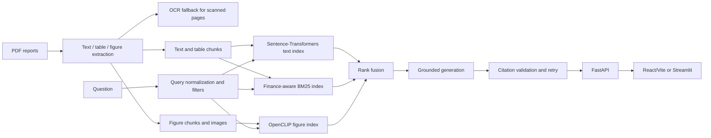

# Meridian: Multimodal RAG for Financial Documents

Meridian is a reproducible research prototype for grounded enterprise financial-document search.
It ingests annual reports and other PDFs, extracts text, tables, figures, and OCR evidence, retrieves
across separate modality-aware indexes, and generates answers whose citations are checked against the
retrieved evidence before they are shown.

> **Research prototype — not financial advice.**

The project is designed to make financial reports easier to understand without hiding provenance.
Every evidence item retains its document ID, page, modality, source path, optional image path,
bounding box, caption, section heading, and OCR metadata.

## What the product does

- Extracts PDF text, structured tables, figures, captions, and scanned-page OCR.
- Stores text/table and figure embeddings in separate vector spaces.
- Combines dense retrieval with finance-aware BM25 retrieval.
- Fuses ranked results with Reciprocal Rank Fusion (RRF) or independently weighted ranks.
- Filters and explains results by document, fiscal year, modality, and query intent.
- Supports grounded generation through Gemini, Anthropic, OpenAI-compatible endpoints, Ollama, or
  an explicitly selected deterministic `MockLLM` for offline tests.
- Validates every generated citation and retries once with a stricter prompt before abstaining.
- Performs evidence-bound numerical parsing and `Decimal` calculations.
- Provides a FastAPI backend, a React/Vite product UI, and a Streamlit compatibility client.
- Saves reproducible evaluation reports with per-question results, confidence intervals, metrics,
  configuration, and plots.

## Architecture



The text/table encoder and CLIP encoder are never compared through raw similarity values. Each
retriever produces a ranked list of chunk IDs; only the rank-fusion layer combines those lists.
Figure captions, nearby text, and OCR remain available through the text/BM25 route while the
original image remains available for vision-capable generation and source inspection.

## Repository layout

```text
configs/                  Runtime configurations for default, baseline, and production modes
data/
  eval/                   Fixture and real-corpus evaluation question sets
  manifests/              Corpus metadata, URLs, checksums, and readiness
  raw/                    Source PDFs and generated fixtures
  processed/              Fixture extraction output
  real_processed/         Real-corpus extraction output
  indexes/                Fixture indexes
  real_indexes/           Real-corpus indexes
docs/                     Architecture, evaluation, design review, results, and deviations
frontend/
  src/                    React application, components, tokens, styles, and tests
  e2e/                    Playwright browser and accessibility tests
scripts/                  Fixture, corpus, extraction, evaluation, and app utilities
src/mmrag/
  api/                    FastAPI application and endpoints
  app/                    Streamlit compatibility client
  baseline/               Fair text-only transformation
  embedding/              Sentence-Transformers, CLIP, reranker, and cache adapters
  evaluation/              Metrics, runner, reports, and regression checks
  extraction/              Text, table, and figure extraction
  generation/              Providers, prompts, citations, reasoning, and answer pipeline
  indexing/                Dense and BM25 persistence
  ingestion/               PDF loading and OCR
  retrieval/               Query normalization, hybrid retrieval, and fusion
  schemas.py               Typed Pydantic data contracts
  pipeline.py              End-to-end orchestration
tests/                    Python unit and integration tests
```

## Requirements

- Windows, macOS, or Linux
- Python 3.11 or newer
- [uv](https://docs.astral.sh/uv/)
- Node.js and npm for the React frontend
- Tesseract OCR for scanned-document OCR
- Optional: Docker Desktop
- Optional: provider credentials for live answer generation

The project uses `pyproject.toml` and `uv.lock` for Python dependencies and
`frontend/package-lock.json` for frontend dependencies.

## Installation

### Offline development and CI dependencies

```powershell
uv sync --extra dev --extra app --extra eval --extra tables
npm install --prefix frontend
```

### Full production-model dependencies

```powershell
uv sync --extra models --extra ocr --extra tables --extra app --extra eval --extra dev
```

The `models` extra installs FAISS, Sentence-Transformers, and OpenCLIP. The `ocr` extra installs
the Python Tesseract adapter; the native Tesseract executable must also be installed and available
on `PATH`.

Verify OCR:

```powershell
tesseract --version
```

## Configuration

Configuration is YAML-based and validated into typed settings.

| File | Purpose | Generation provider | Data paths |
|---|---|---|---|
| `configs/default.yaml` | Deterministic local workflow | `mock` | `data/processed`, `data/indexes` |
| `configs/baseline.yaml` | Fair text-only comparison | inherited/default values plus flattened tables and no figures | fixture paths |
| `configs/production.yaml` | Real corpus and live provider | `gemini-3.5-flash-lite` | `data/real_processed`, `data/real_indexes` |

Important settings include:

- `embedding.text_model`: Sentence-Transformers checkpoint for text and table chunks.
- `embedding.clip_model` and `embedding.clip_pretrained`: OpenCLIP architecture and checkpoint.
- `embedding.device`: `auto`, CPU, or configured accelerator.
- `retrieval.top_k` and `retrieval.candidate_k`: final and candidate result sizes.
- `retrieval.fusion`: `rrf` or `weighted`.
- `generation.provider`, `generation.model`, `generation.use_vision`, and retry/timeout values.
- `baseline.tables_flat` and `baseline.figures`: transformations used only for the fair baseline.

Never put credentials in YAML or source files. Copy `.env.example` to a local, git-ignored `.env`
and set the variable required by the selected provider. The frontend never receives provider keys.

## Quick start: deterministic fixture

This is the fastest complete workflow and does not require an external LLM:

```powershell
uv run python scripts/make_fixtures.py
uv run mmrag ingest data/raw --force
uv run mmrag index
uv run mmrag index --baseline
uv run mmrag ask "What was revenue in FY2024?"
uv run mmrag ask "Which segment expanded during FY2024?"
uv run mmrag ask "What does Figure 1 show?"
uv run mmrag eval --run-id fixture-local
```

The fixture intentionally contains text, a financial table, a chart, and an image-only scanned
page. It is a plumbing and regression fixture, not evidence of real-world answer quality.

## Real corpus workflow

The tracked manifest contains 15 public annual reports. Verify the local corpus first:

```powershell
uv run python scripts/verify_corpus.py `
  --manifest data/manifests/corpus.csv `
  --raw data/raw
```

Expected result for the current checked-in corpus:

```text
ready=15 missing=0 invalid=0 total=15
```

Ingest and index the real corpus:

```powershell
uv run mmrag ingest data/raw --manifest data/manifests/corpus.csv --config configs/production.yaml
uv run mmrag index --config configs/production.yaml
uv run mmrag index --config configs/baseline.yaml --baseline
```

Before using the data for a benchmark, inspect representative paragraph, table, multi-column,
figure, and scanned pages. Extraction reports are written under `reports/real/`.

## Command-line interface

The installed `mmrag` command is defined in `src/mmrag/cli.py`.

```text
mmrag ingest SOURCE [--config CONFIG] [--force] [--manifest MANIFEST]
mmrag index [--config CONFIG] [--baseline]
mmrag retrieve QUERY [--config CONFIG] [--k K] [--baseline]
mmrag ask QUERY [--config CONFIG] [--k K] [--baseline]
mmrag eval [--gold GOLD] [--config CONFIG] [--run-id RUN_ID]
mmrag modalities
```

Examples:

```powershell
uv run mmrag retrieve "What were operating margins?" --config configs/production.yaml
uv run mmrag ask "How did services compare with products?" --config configs/production.yaml
uv run mmrag eval --gold data/eval/fixture_gold.jsonl --run-id fixture-$(Get-Date -Format yyyyMMdd)
```

## Running the applications

### Simple steps: run the 15-report application

The checked-in corpus contains 15 verified annual reports. From the repository root:

1. Install the Python and frontend dependencies:

   ```powershell
   uv sync --extra models --extra ocr --extra tables --extra app --extra eval --extra dev
   npm install --prefix frontend
   ```

2. Make sure `data/raw/` contains the reports and verify them:

   ```powershell
   uv run python scripts/verify_corpus.py `
     --manifest data/manifests/corpus.csv `
     --raw data/raw
   ```

   The expected result is `ready=15 missing=0 invalid=0 total=15`.

3. Configure the live provider in `.env`. For the default production configuration, set
   `GEMINI_API_KEY`. Keep this file local; it is ignored by Git.

4. Start the API and React application together:

   ```powershell
   uv run python scripts/run_app.py --config configs/production.yaml
   ```

5. Open [http://127.0.0.1:5177](http://127.0.0.1:5177). The API is available at
   [http://127.0.0.1:8010/docs](http://127.0.0.1:8010/docs), and its health check is
   [http://127.0.0.1:8010/health](http://127.0.0.1:8010/health).

For a quick offline demo using the synthetic fixture instead of the 15 real reports, run:

```powershell
uv run python scripts/run_app.py --config configs/default.yaml
```

### FastAPI and React UI

```powershell
uv run uvicorn mmrag.api.app:create_app --factory --reload --port 8000
npm run dev --prefix frontend
```

The Vite development server normally runs at `http://127.0.0.1:5173` and proxies API requests
according to `frontend/vite.config.ts`. The backend health endpoint is:

```text
GET http://127.0.0.1:8000/health
```

The production-oriented combined launcher is:

```powershell
uv run python scripts/run_app.py --config configs/production.yaml
```

### Streamlit compatibility client

```powershell
uv run --extra app streamlit run src/mmrag/app/streamlit_app.py
```

The React UI is the primary product interface. It includes:

- Conversational question composer with custom document scope selection.
- Text, table, and figure evidence presentation.
- Citation chips opening a page-level source drawer with bounding-box highlighting.
- Document library, upload jobs, progress, retry, cancellation, and removal.
- Saved history and question reruns.
- Evaluation/quality reports.
- Settings for retrieval and answer style.
- Responsive mobile layout, keyboard navigation, reduced-motion support, dark mode, and accessibility
  coverage.

## How Meridian differs from a normal chatbot

A normal chatbot usually generates an answer from its language-model knowledge or from a
conversation, without proving which document and page support each statement. Meridian is a
document-grounded research system:

- It searches the supplied financial reports rather than relying only on general model knowledge.
- It searches text, tables, figures, captions, and OCR evidence using separate indexes.
- It keeps provenance such as document, page, modality, source path, and image location for every
  evidence item.
- It shows citations that are checked against the retrieved evidence before an answer is displayed.
- It performs financial calculations with evidence-bound values and precise `Decimal` arithmetic.
- If the reports do not provide enough support, it retries with stricter citation requirements and
  can return `Insufficient evidence` instead of inventing an answer.

In short, a normal chatbot is optimized for fluent conversation; Meridian is optimized for
traceable, evidence-backed answers over a defined document collection.

## API reference

The FastAPI application exposes:

| Method | Path | Purpose |
|---|---|---|
| GET | `/health` | Service health |
| GET | `/diagnostics` | Runtime/provider diagnostics |
| GET | `/documents` | List indexed documents |
| GET | `/documents/{doc_id}` | Document details and extracted multimodal evidence |
| POST | `/documents/{doc_id}/reindex` | Rebuild one document's indexes |
| POST | `/documents/{doc_id}/reingest` | Queue document re-ingestion |
| DELETE | `/documents/{doc_id}` | Remove a document after confirmation |
| POST | `/retrieve` | Return ranked evidence |
| POST | `/ask` | Return a citation-gated answer |
| POST | `/ask/stream` | Stream answer events |
| POST | `/jobs/upload` | Queue a PDF/image upload |
| GET | `/jobs` | List ingestion jobs |
| GET | `/jobs/{job_id}` | Read job progress |
| POST | `/jobs/{job_id}/cancel` | Cancel a job |
| POST | `/jobs/{job_id}/retry` | Retry a failed job |
| GET/PUT | `/settings` | Read or update runtime settings |
| GET/PATCH/POST/DELETE | `/history...` | Manage saved questions |
| GET | `/evaluations` | List saved evaluation runs |
| GET | `/evaluations/{run_id}` | Read one evaluation |
| GET | `/figure/{chunk_id}` | Serve extracted figure evidence |
| GET | `/page/{doc_id}/{page}.png` | Render a source page |
| GET | `/page/{doc_id}/{page}/metadata` | Read page dimensions and metadata |

Interactive API documentation is available at `/docs` when the FastAPI server is running.

## Grounding and answer behavior

1. The query is normalized and optional document, fiscal-year, and modality filters are applied.
2. Text/table dense retrieval, finance-aware BM25, and figure retrieval produce independent ranked
   lists.
3. RRF or independently normalized weighted fusion creates the final evidence order.
4. The answer prompt includes only retrieved evidence and provenance.
5. Generated citation labels are parsed and resolved to retrieved chunk IDs.
6. If validation fails, generation retries once with a stricter citation prompt.
7. If the second attempt fails, the answer is `Insufficient evidence`.

Numerical reasoning uses provenance-carrying values and `Decimal`. Supported forms include
currencies, percentages, basis points, thousands, lakhs, millions, crores, and billions.

Chart-to-data reconstruction is intentionally out of scope. The product does not claim exact chart
values unless they are present in a caption, OCR, nearby text, or an extracted table.

## Evaluation

Evaluation is reproducible and writes artifacts under `reports/<run_id>/`:

- `config.json`: exact runtime configuration.
- `environment.json`: environment and model information where available.
- `metrics.json`: aggregate metrics and confidence intervals.
- `per_question.jsonl`: raw question-level outcomes.
- `summary.md`: human-readable report.
- `plots/`: generated charts.

Metrics include Recall@K, Precision@K, MRR, citation-valid rate, grounded rate, numeric exact
match, latency, token usage, failure categories, and question-type/document/modality breakdowns.
Bootstrap confidence intervals use a fixed seed; paired comparisons operate on per-question deltas.

The fair baseline uses the same questions, retrieval budget, and evaluation runner. It only flattens
tables into text and excludes figures. It does not receive a weaker query or a different gold set.

### Current measured data

The real corpus currently contains 15 verified PDFs, 3,868 extracted pages, and 14,145 evidence
chunks. A 60-question retrieval-only evaluation is saved in
`reports/real/retrieval_verified/`; it is not a full live-answer evaluation.

Fixture results are deliberately labelled synthetic. For example, the verified local fixture run
under `reports/fixture-verified-20261105/` contains three questions and reports citation validity,
retrieval metrics, latency, and numeric checks. These numbers must not be presented as real-corpus
quality.

## Verification commands

Run the complete local checks:

```powershell
uv run pytest
uv run ruff check .
uv run ruff format --check .
uv run mypy src/mmrag
npm test --prefix frontend
npm run e2e --prefix frontend
npm run build --prefix frontend
uv run python scripts/verify_corpus.py --manifest data/manifests/corpus.csv --raw data/raw
```

Current verified results after the UI and answer-formatting changes:

- Python tests: **63 passed**
- Frontend unit tests: **8 passed**
- Frontend browser/accessibility tests: **4 passed**
- Frontend production build: **passed**
- Ruff check and formatting: **passed**
- Strict mypy: **passed**
- Corpus verification: **15 ready, 0 missing, 0 invalid**

## Docker

Build and run the API when Docker Desktop's Linux engine is available:

```powershell
docker compose build
docker compose up
```

The compose service exposes port `8000` and mounts `data/` and `reports/`. Docker verification is
environment-dependent; on the last recorded verification the Docker API returned HTTP 500, so a
clean-container result is not claimed.

## Security and privacy

- Never commit `.env`, API keys, or provider tokens.
- Provider keys stay server-side and are never sent to the React client.
- Upload paths and saved evaluation paths are confined by the API.
- Provider errors are sanitized so credentials are not serialized into responses or logs.
- Uploads are size/type checked and ingestion jobs are cancellable.
- Production mode fails clearly when credentials or required model dependencies are missing.
- Public filings and synthetic fixtures are the accepted corpus sources.

## Known limitations and deviations

See [docs/deviations.md](docs/deviations.md) for the authoritative list. Important limits:

- A live provider is required for production answer generation; the default mock provider is only
  for deterministic offline workflows.
- Full real Gemini answer-quality evaluation may be interrupted by provider rate limits or HTTP 503
  responses and must not be represented as complete when partial.
- OCR quality depends on the native Tesseract installation and document scan quality.
- Chart-to-data reconstruction is not supported.
- Model checkpoint licences must be reviewed separately from package licences.
- Docker verification depends on a working Docker Linux engine.

## Documentation map

- [Architecture](docs/architecture.md)
- [Evaluation protocol](docs/evaluation.md)
- [Implementation status](docs/implementation_status.md)
- [Results](docs/results.md)
- [Deviations and environment constraints](docs/deviations.md)
- [Design audit](docs/design-review/00-audit.md)
- [Design decisions](docs/design-review/DECISIONS.md)
- [Real-corpus visual review](docs/REAL_CORPUS_VISUAL_REVIEW.md)
- [Gold-set review](docs/gold_set_review.md)
- [API source](src/mmrag/api/app.py)
- [Frontend source](frontend/src/)

## Team ownership

- Rishith Pai — ingestion, extraction, and corpus
- Jitin Kumarapu — embeddings, retrieval, and architecture
- Anerudh Ramachandran — generation, grounding, and evaluation
- Sachin Bhat — baseline, evaluation, and UI

## License and data terms

This repository is a research prototype. Public filing terms, source URLs, retrieval dates, SHA-256
checksums, and document statuses are recorded in `data/manifests/corpus.csv`. Do not redistribute
source documents contrary to their terms. Review each model checkpoint licence before production
use. No output should be interpreted as investment, accounting, tax, or legal advice.
